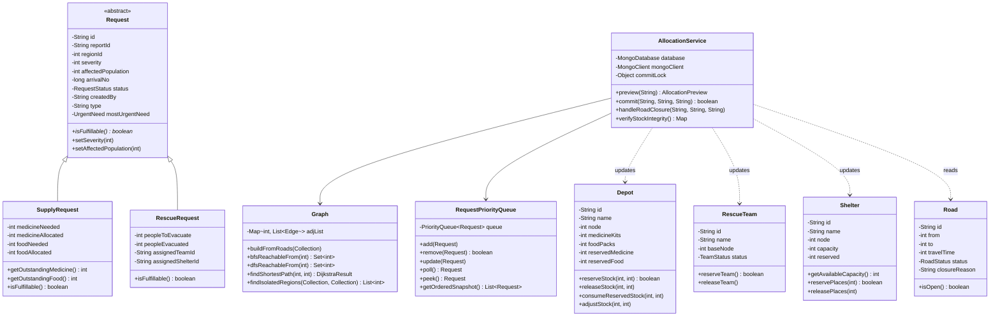
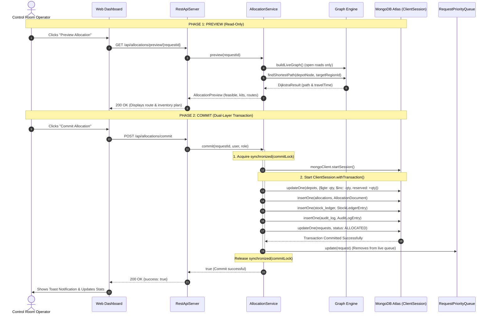

# System Architecture & Technical Design Document

This document details the architectural choices, mathematical models, data structures, database schemas, and concurrency mechanisms underpinning the **Disaster Relief Resource Allocation and Prioritisation System**.

---

## 1. Why Each Data Structure Fits

| Data Structure | Component | Algorithmic Complexity | Architectural Justification |
| :--- | :--- | :--- | :--- |
| **`PriorityQueue<Request>`** (Binary Heap) | Triage Engine (`RequestPriorityQueue`) | Insert: $O(\log n)$<br>Poll: $O(\log n)$<br>Peek: $O(1)$<br>Update: $O(n)$ | Triage requires retrieving the highest-urgency incident instantly. A binary heap ensures top-priority incidents always remain at the root without requiring a full sort ($O(n \log n)$). Updating a modified request performs a linear array scan ($O(n)$) followed by heapification. |
| **`HashMap<Integer, List<Edge>>`** | Road Graph (`Graph`) | Lookup: $O(1)$<br>Space: $O(V + E)$ | Road networks are sparse planar graphs ($E \ll V^2$). Adjacency lists minimize memory footprint while providing constant-time vertex neighbor expansion during pathfinding. |
| **`HashSet<Integer>`** | Graph Traversal (`visited`) | Add / Contains: $O(1)$ | Prevents infinite loops and cyclic revisits during graph explorations. Amortized $O(1)$ membership checks guarantee $O(V + E)$ overall traversal time. |
| **`ArrayDeque<Integer>`** | Breadth-First Search | Push / Poll: $O(1)$ amortized | Cache-friendly, ring-buffer FIFO queue that outperforms `LinkedList` by eliminating per-node object allocation overhead during high-frequency BFS traversals. |
| **`Deque<Integer>` (Stack)** | Depth-First Search | Push / Pop: $O(1)$ | Explicit call-stack simulation avoiding JVM recursion depth limits on large deep graphs. |
| **`ConcurrentHashMap<String, UserSession>`** | Session Management (`SessionManager`) | Read / Write: $O(1)$ | Lock-free segmented hash table providing thread-safe session verification across simultaneous HTTP requests without blocking throughput. |

---

## 2. MongoDB Collection Architecture & Schema Design

The application utilizes 13 distinct collections with manual Document mapping for complete control and transparency:

```
├── users           : User credentials, PBKDF2 hash, salt, role, and jurisdiction regions
├── nodes           : 14 topological vertices (10 regions, 2 depots, 2 shelters)
├── roads           : Undirected weighted edges with travel time and status (OPEN/CLOSED)
├── regions         : 10 administrative disaster zones with baseline populations
├── depots          : 2 central supply depots tracking medicine kits and food packs
├── teams           : 3 search-and-rescue teams (AVAILABLE / BUSY)
├── shelters        : 2 disaster shelters with capacity and reserved tracking
├── requests        : Polymorphic requests (type: "SUPPLY" or "RESCUE", shared reportId)
├── allocations     : Dispatch records mapping requests to assets, routes, and ETAs
├── stock_ledger    : Append-only immutable ledger recording every unit delta
├── audit_log       : Administrative and security timeline of all mutations
├── alerts          : Control room notifications (e.g. road closures hitting active missions)
└── counters        : Atomic monotonic arrival sequence counter ({_id: "arrival", seq: n})
```

### Idempotent Startup Indexes
1. `users`: Unique index on `username` (`idx_users_username_unique`).
2. `requests`: Compound triage index on `(status ASC, severity DESC, affectedPopulation DESC, arrivalNo ASC)` (`idx_requests_triage`).
3. `roads`: Compound index on `(from ASC, to ASC)` (`idx_roads_endpoints`).
4. `stock_ledger`: Descending index on `timestamp` (`idx_stock_ledger_ts`).
5. `audit_log`: Descending index on `timestamp` (`idx_audit_log_ts`).

---

## 3. Dual-Layer Concurrency Architecture

To guarantee zero double-promising of scarce relief resources, the system employs two independent layers of concurrency control:

```
[ Incoming Allocation Request ]
               │
               ▼
┌────────────────────────────────────────────────────────┐
│ LAYER 1: In-Process Synchronized Monitor Lock          │
│   synchronized (commitLock)                            │
│   - Enforces strict sequential order within the JVM.   │
│   - Prevents multi-threaded local race conditions      │
│     between simultaneous dashboard button presses.     │
└────────────────────────────────────────────────────────┘
               │
               ▼
┌────────────────────────────────────────────────────────┐
│ LAYER 2: MongoDB Multi-Document ACID Transaction        │
│   ClientSession.withTransaction()                      │
│   - Atomic conditional update guards:                  │
│       • Stock: updateOne({_id, medicineKits: {$gte: qty}})
│       • Team:  updateOne({_id, status: "AVAILABLE"})   │
│       • Shelter: updateOne({_id, $expr: {$gte: ...}})  │
│   - Verified via: modifiedCount == 1                   │
│   - Distributed safety: Even across multiple server    │
│     instances or clustered processes, double-promising │
│     is mathematically rejected and rolls back cleanly. │
└────────────────────────────────────────────────────────┘
```

---

## 4. Mermaid UML Class Diagram



---

## 5. Sequence Diagram: Two-Phase Allocation (Preview &rarr; Commit)



---

## 5. Severity and Triage Method (START & Decision Table)

### 5.1 START Mass-Casualty Background & Honest Labelling
The casualty assessment follows the **START (Simple Triage and Rapid Treatment)** mass-casualty protocol:
1. **Can walk?** &rarr; Classified as **Green (Minor)**.
2. **Breathing?** If no, position airway. If still no &rarr; **Black (Deceased / Expectant)**. If rate > 30/min &rarr; **Red (Immediate)**.
3. **Perfusion / Pulse?** If radial pulse absent or capillary refill > 2 sec &rarr; **Red (Immediate)**.
4. **Mental Status / Commands?** If fails to follow simple commands &rarr; **Red (Immediate)**. If breathing, pulse, and commands are fine &rarr; **Yellow (Delayed)**.

#### Honest Labelling Declarations:
- **Triage Authority**: START is an internationally recognized mass-casualty standard, **NOT an official Government of India system**. It must be performed by a trained human responder on scene. The central operator cannot measure vitals; field officers input observed START casualty counts.
- **Project Assumptions**: The Severity 1–5 decision table, numerical thresholds, medicine-kit ratio (10 people/kit), and food-kit ratio (5 people/household/day) are **PROJECT-DEFINED ASSUMPTIONS** adapted from START principles and Sphere Humanitarian Standards. All numbers are centralized in `SeverityConfig` for complete audit transparency.
- **Pediatric Limitation**: Adult START is implemented. Pediatric JumpSTART is **not implemented** in this version.
- **Escalation Levels**: L1 / L2 escalation flags are explicitly labelled **"adapted from national disaster-level ideas"**.

### 5.2 Deterministic Severity Decision Table (Worst-Finding-Wins)
Implemented as a pure function in `SeverityCalculator` with zero database dependencies. Rows are evaluated in strict order; the **first matching condition wins**:

| Level | Severity Label | Rule ID | Deterministic Matching Condition |
| :---: | :--- | :--- | :--- |
| **5** | **Critical** | `RULE_5_IMMEDIATE_RISK_HIGH` | $\text{immediateRisk} \ge 5$ (where $\text{immediateRisk} = \text{red} + \text{trapped}$) |
| **5** | **Critical** | `RULE_5_THREAT_WITH_IMMEDIATE` | $\text{ongoingThreat} = \text{true} \;\land\; \text{immediateRisk} \ge 1$ |
| **4** | **Severe** | `RULE_4_IMMEDIATE_RISK` | $1 \le \text{immediateRisk} \le 4$ |
| **3** | **Serious** | `RULE_3_DELAYED_HIGH` | $\text{delayed} \ge 10$ (where $\text{delayed} = \text{yellow}$) |
| **3** | **Serious** | `RULE_3_ONGOING_THREAT` | $\text{ongoingThreat} = \text{true}$ |
| **3** | **Serious** | `RULE_3_HOURS_WITHOUT_SUPPLIES` | $\text{hoursWithoutSupplies} > 24$ |
| **2** | **Moderate** | `RULE_2_DELAYED` | $1 \le \text{delayed} \le 9$ |
| **2** | **Moderate** | `RULE_2_HOURS_WITHOUT_SUPPLIES` | $12 \le \text{hoursWithoutSupplies} \le 24$ |
| **2** | **Moderate** | `RULE_2_VULNERABLE_PCT` | $\text{vulnerablePct} \ge 0.20$ (20% of total affected) |
| **1** | **Low** | `RULE_1_DEFAULT` | None of the above conditions met |

Every evaluation returns a `SeverityResult {level, label, ruleId, explanation}` containing a transparent, human-readable sentence (e.g. *"Critical: 6 immediate-risk people (threshold 5)"*).

### 5.3 Relief Kit Calculation Ratios
Sphere standards guidance assumptions:
- **Medicine**: $\lceil \text{people} / 10 \rceil$ kits (supports basic trauma and essential meds for 10 individuals).
- **Food**: $\lceil (\text{people} \times \text{days}) / 5 \rceil$ rations (assumes 2,100 kcal daily survival ration for a 5-person household).
- If field officers edit suggested kit numbers, a mandatory justification reason is stored.

### 5.4 The "Need-First" Tie-Breaking Mechanism
- **Within-Region vs. Between-Region Priorities**:
  - Severity Level decides priority **BETWEEN** different regions ($\text{Severity DESC} \to \text{Population DESC}$).
  - The officer's ranked `needOrder` decides priority **WITHIN** an individual region.
- **Request Generation & Arrival Sequence Assignment**:
  - A report generates up to two linked requests: a `RescueRequest` (rescue + shelter) and a `SupplyRequest` (medicine + food).
  - The request containing the **#1 ranked need** in `needOrder` is awarded the lower atomic `arrivalNo` from the monotonic counter.
  - In the comparator tie-break ($\text{Severity DESC} \to \text{Population DESC} \to \text{ArrivalNo ASC}$), both requests have identical severity and population, so the request with the #1 ranked need wins the tie-break!
  - Within each request, the `items[]` array is maintained in `needOrder` sequence.

---

## 6. Unit & Integration Test Matrix

All 44 automated test cases pass 100% green:

| Test Suite / Class | Test Count | Status | Key Verifications |
| :--- | :---: | :---: | :--- |
| `SeverityCalculatorTest` | 13 | **PASS** | Decision table boundary values (0, 1, 4, 5, 9, 10, 11, 12, 24, 25, 19%, 20%), division-by-zero protection, first-match-wins rule, ceil kit rounding, and input validations. |
| `ReportWorkflowTest` | 4 | **PASS** | Need-first tie-breaking sequence assignment, recount update severity recalculation, override clearing with alerts, Control Room RBAC authorization, and duplicate prevention. |
| `DisasterReliefSystemTest`| 7 | **PASS** | Multi-document ACID transactions, partial allocations, full shelter guards, cut-vertex road isolation, dynamic re-ranking, and mathematical ledger conservation. |
| `PureAllocationLogicTest` | 6 | **PASS** | Pure algorithmic allocation invariants, shortfalls, shelter capacity caps, and isolation. |
| `PriorityQueueTest` | 6 | **PASS** | Binary heap multi-criteria comparator, tie-breaking determinism, and $O(n)$ update operations. |
| `GraphAlgorithmTest` | 4 | **PASS** | BFS/DFS reachability equivalence ($O(V+E)$), Dijkstra shortest path with positive weights ($O((V+E)\log V)$). |
| `PasswordUtilTest` | 1 | **PASS** | PBKDF2 125,000-iteration cryptographic key derivation. |
| `RbacAndSecurityTest` | 3 | **PASS** | Role boundaries, session management, and HTTP 401/403 access control. |
| **TOTAL** | **44** | **100% PASS** | **Zero failures, zero errors.** |

